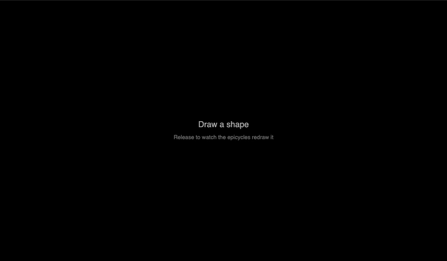
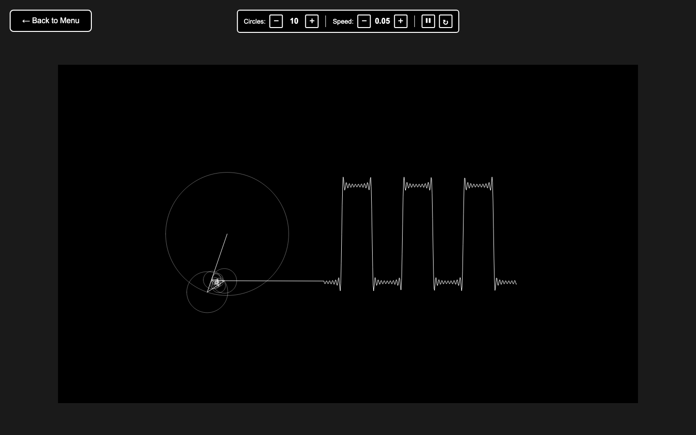
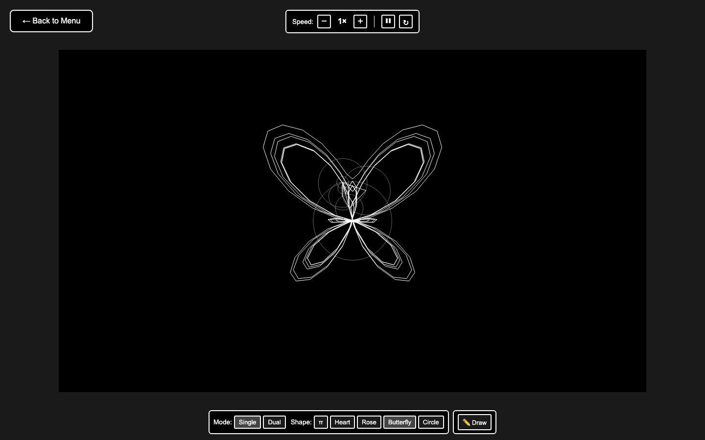
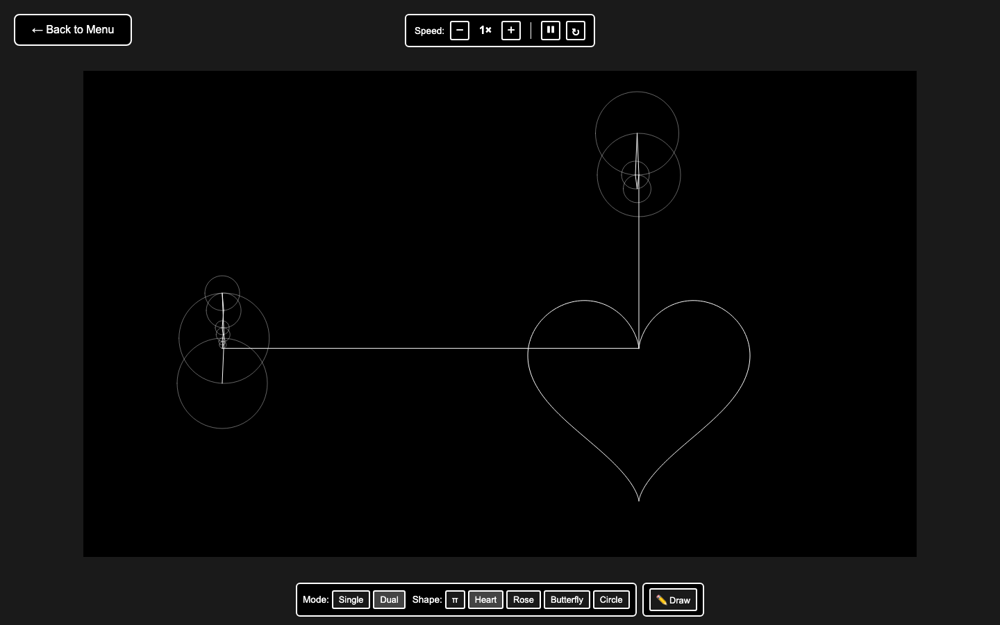
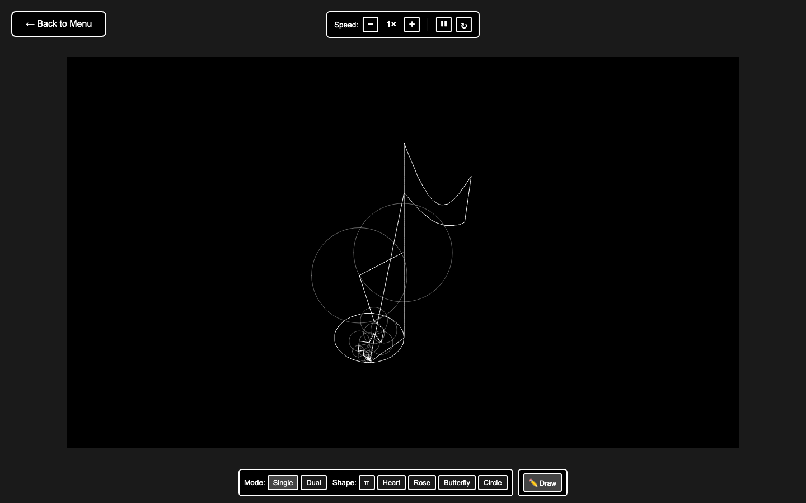
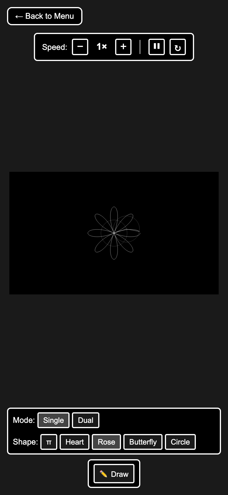

# Fourier: the prism for signals

**An interactive visualizer of Fourier series and the discrete Fourier transform.** Rotating
circles stacked tip to tail (epicycles) build a square wave, redraw shapes, and redraw anything you
draw yourself.

**Live demo: [4k45h107.github.io/fourier-transformation-drawing](https://4k45h107.github.io/fourier-transformation-drawing/)**



*Draw a shape, release, and the epicycles redraw it.*

## Screenshots

| | |
| --- | --- |
|  |  |
| **Fourier series:** a square wave from its odd harmonics | **Single mode:** one chain of circles draws the butterfly curve |
|  |  |
| **Dual mode:** one chain draws x, another draws y | **Freehand:** your own drawing, redrawn |

<p align="center"></p>

## Features

**Fourier Series: Square Wave**
- A square wave built from its odd harmonics, one circle per harmonic.
- Change the number of circles (1 to 50) and watch the corners sharpen, including the overshoot at
  the jumps (the Gibbs phenomenon).
- Speed control, pause and reset.

**Fourier Transformation Arts**
- **Shapes:** π, heart, rose, butterfly and circle, each turned into points, transformed, and
  redrawn by epicycles.
- **✏️ Draw:** draw any shape with the mouse or a finger; on release, the epicycles redraw it.
- **Two modes:**
  - **Single:** one chain of circles for the whole curve.
  - **Dual:** one chain draws the x coordinate and another draws y, so you can see each part
    separately.
- **Speed:** 0.25× to 4×, plus pause and reset.

**Everywhere**
- Fits any screen, from phones to large monitors, and keeps fitting when the window is resized or a
  phone is rotated.
- No build step and no dependencies at runtime: plain JavaScript and [p5.js](https://p5js.org/).

## How it works

**Square wave (Fourier series).** A square wave is a sum of odd sine waves:

```
square(t) = (4 / π) · ( sin t + sin 3t / 3 + sin 5t / 5 + … )
```

Each term becomes a circle with radius `4 / (nπ)` spinning at speed `n`. Stacking the circles tip
to tail, the last tip traces the wave, which is plotted to the right as time moves on.

**Any shape (discrete Fourier transform).**
1. The shape is sampled into N points (300 for most shapes, 400 for freehand drawings).
2. A DFT turns those points into N frequency components, each with an amplitude, a phase and a
   speed.
3. Each component becomes one circle. Sorted largest first, the circles' combined tip retraces the
   original shape over one full turn.

**Single vs dual.**
- **Single:** each point is a complex number `x + iy`, so one transform and one chain of circles
  draw the curve.
- **Dual:** x and y are transformed separately. The top chain moves horizontally (x), the left chain
  vertically (y), and the pen sits where the two meet.

**Freehand drawing.**
1. The stroke is closed with a straight line back to its start, because the transform treats a
   shape as a loop.
2. It's resampled into evenly spaced points, so fast and slow parts of the stroke get equal detail.
3. It's centred, and scaled down to fit the mode's drawing area if needed.

**Speed control.** The DFT reproduces the shape exactly at its sample points, not between them. So
time always moves in whole sample steps: at 4× the drawing takes four steps per frame (recording the
pen at each one, so the line stays smooth), and at 0.25× it takes one step every fourth frame.

**Fitting the screen.** Everything is drawn in a fixed 1200×700 space. The canvas is scaled to the
largest size that fits, and mouse and touch input are scaled back, so drawing lands exactly under
your finger at any size. The control panel goes beside the canvas or in a compact row below it,
whichever leaves the bigger canvas.

## Running it locally

It's a static site. Open `index.html` in a browser, or use the dev server for live reload:

```bash
npm install
npm run dev     # opens http://localhost:3000 and reloads on save
```

## Project structure

```
index.html                      Menu and script loading
css/                            Menu and sketch styles (including small-screen layouts)
js/main.js                      Router, canvas fitting, pointer handling
js/menu.js                      Menu buttons
js/sketches/square-wave.js      Fourier series: square wave
js/sketches/draw-with-...js     Fourier transformation arts: shapes, speed, freehand drawing
js/modes/                       Single (complex DFT) and dual (x and y) epicycle modes
js/components/                  Control bars and the Mode/Shape/Draw panel
js/utils/fourier.js             DFT for real and complex signals
js/utils/signal-generator.js    Shape generators and freehand resampling
lib/p5.min.js                   p5.js 1.7.0
```

## Deployment

Hosted on GitHub Pages from the `main` branch; every merge to `main` updates the live site.
